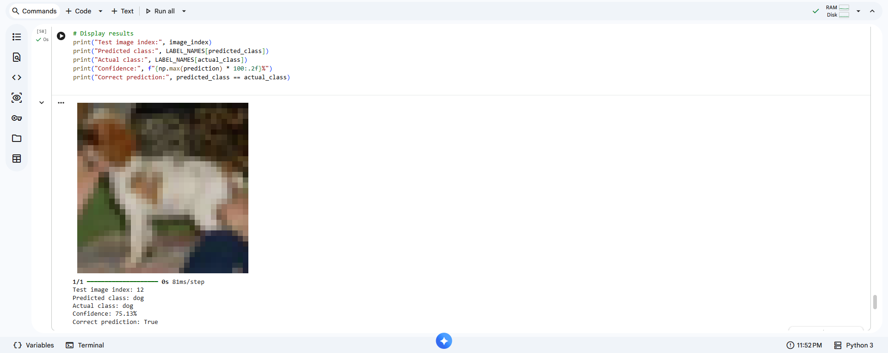
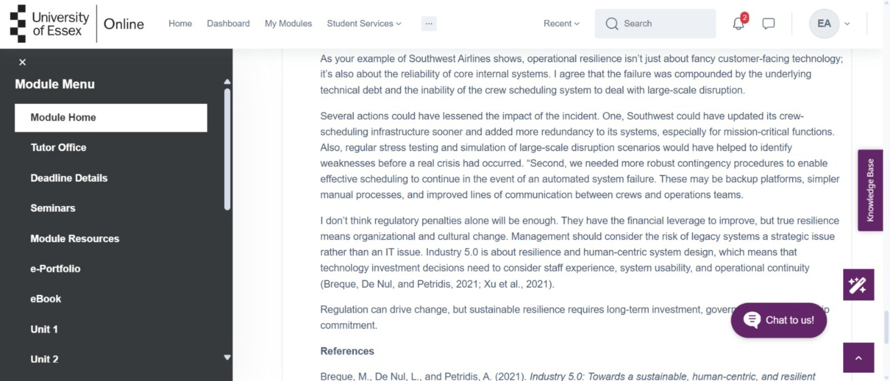

# Machine Learning – ML_PCOM7E e-Portfolio

**Student:** Essa Albuainain  
**Institution:** University of Essex Online  
**Module:** Machine Learning (ML_PCOM7E)  
**Portfolio:** https://essaalbuainain.github.io/machine-learning-eportfolio/

## Introduction and Learning Outcomes

This e-Portfolio demonstrates my learning in the Machine Learning module Units 1-12 via practical activities, collaborative discussions and assessed projects. It shows my development in technical evaluation, critical reflection, ethical awareness and virtual team work.

### Learning Outcomes and Supporting Evidence

| Learning Outcome | Supporting Portfolio Evidence |
|---|---|
| **LO1 – Legal, Social, Ethical and Professional Issues** | Unit 9 ethical reflection, pneumonia classification risks and AI discussions. |
| **LO2 – Dataset Suitability and Evaluation** | Auto-MPG analysis, Airbnb data exploration and chest X-ray limitations. |
| **LO3 – Machine Learning Methods and Critical Evaluation** | Regression, K-Means, CNN, HOG–SVM and regularisation experiments. |
| **LO4 – Virtual Teamwork and Collaboration** | Airbnb group project, peer evaluation, tutor feedback and collaborative discussions. |

## Units 1–4: Foundations, EDA and Regression

Unit 1 covered supervised and unsupervised methods and the machine-learning life cycle. Exploration of the Unit 2 Auto-MPG data found six missing values for horsepower and negative relationships between fuel economy and vehicle weight, displacement, and cylinders. Missingness and correlation had to be investigated before modeling.

*Figure 1. Auto-MPG correlation evidence.*

Unit 3 Correlation Linear and polynomial regression Modeling assumptions Overfitting Unit 4 covered fuel consumption and population-GDP relationships (2001-2021) Association alone cannot be used to establish causation or predictive usefulness.

*Figure 2. Correlation and regression.*

*Figure 3. Population–GDP exercise.*

## Units 5–6: Similarity and Clustering

Jaccard distances were Jack–Mary **0.7273**, Jack–Jim **0.4444**, and Jim–Mary **0.9231**; attribute representation determines similarity.

*Figure 4. Jaccard calculations.*

The K-Means wiki went over centroid selection and cluster interpretation. The selection of k was validated using elbow plots. Iris clustering: silhouette = 0.459 and adjusted Rand index = 0.6201. The results suggest partially meaningful clusters, not perfect retrieval of known classes (Rousseeuw, 1987).

*Figure 5. Wiki participation.*

*Figure 6. Iris clustering.*

## Unit 6: Airbnb Group Project

Using New York City Airbnb data (Dgomonov, 2019), we compared Linear Regression, Random Forest (Breiman, 2001), and XGBoost (Chen and Guestrin, 2016).

| Model | Test R² |
|---|---:|
| Linear Regression | 0.501 |
| Tuned Random Forest | 0.608 |
| Untuned XGBoost | 0.617 |
| Tuned XGBoost | **0.623** |

The best performer overall was Tuned XGBoost, but errors were not evenly distributed across price bands. The cheapest listings were overestimated by about **$17**, and listings over **$500** were underestimated by about **$866** on average. This made a limited mid-market pricing pilot more defensible than open-ended recommendations. The group report further noted that despite the higher silhouette score of a solution with two clusters, four clusters were chosen for business usefulness. That trade-off had to be exposed, not presented as statistical optimality.

*Figure 7. Model comparison.*

Guest data was unavailable and therefore four **supply-side** rather than customer clusters were identified. The “listed but not booking” segment represented **22.5%** of listings, indicating that availability did not translate into confirmed bookings.

*Figure 8. Supply segmentation.*

I finished my part and read through the whole group report for coherence and presentation. The review also made me more aware of how the methods, charts and commercial conclusion must support each other rather than appear as disconnected contributions. **29/35** was my peer self-evaluation, with tutor feedback requesting more interpretation of the business and critical justification.

*Figure 9. Tutor feedback.*

*Figure 10. Peer evaluation.*

## Units 7–8: Neural Networks and Optimisation

Perceptron exercises with weighted inputs, bias, and AND classification. Gradient descent showed sensitivity to parameters. 100 iterations with 0.08 gave cost 0.004121 while 0.10 diverges to about 5.97 × 1028. Cost reduction with iterations (0.01) from **0.480407** (100) to **0.031985** (500). MovieLens outputted **RMSE 1.0400** and **MAE 0.8358**.

*Figure 11. Perceptron exercise.*

*Figure 12. Gradient descent.*

*Figure 13. Parameter comparison.*

*Figure 14. Recommender performance.*

## Unit 9: CNN Classification and Ethics

Changing the test image to **`x_test[12]`** the correct prediction was **dog** with **75.13% confidence** as verified by `y_test[12]`. This gave additional evidence rather than just one image. The true class and predicted class were checked at the same index, thus avoiding the misleading comparison we get when different indices are used for the image and label. Correctly classified, confidence < 100%.

*Figure 15. Alternative test image and prediction.*

The separate ethical reflection considered classification errors, dataset bias, privacy and oversight by humans. Robust evaluation and transparent limits are necessary for responsible deployment (Ghallab, 2019). The adversarial-image research also points to challenges in interpretation (Zhou and Firestone, 2019).

## Unit 10: CNN Feature Maps

Correct classification of an external car image was **99.59%** and a teacup was labeled **airplane** at **52.78%**: the classifier could not reject an unfamiliar class (Hendrycks and Gimpel, 2017).

*Figure 16. Car prediction.*

*Figure 17. Teacup prediction.*

`conv2d` feature maps exhibited local pattern responses, while `conv2d_1` had more selective activations with some filters being nearly inactive. While ReLU provides non-linear representation, the activation maps **do not explain why** a classification is made.

*Figure 18. First convolutional layer.*

*Figure 19. Subsequent convolutional layer.*

## Unit 11: Individual Pneumonia Investigation

I compared a custom CNN to HOG–Linear SVM (Cortes and Vapnik, 1995) on chest X-rays (Mooney, 2018). Development used five group-aware folds and an independent **hold out set of 1,165 images**. Subject grouping was determined from filenames, not verified patient identifiers.

| Metric | HOG–SVM | CNN |
|---|---:|---:|
| Accuracy | **94.51%** | 91.93% |
| Sensitivity | **95.17%** | 91.17% |
| F1-score | **96.19%** | 94.28% |
| False negatives | **41** | 75 |

The simpler SVM did better than the CNN. False negatives were particularly consequential, and limited demographics precluded meaningful subgroup-fairness conclusions.

*Figure 20. Holdout results.*

Sometimes Grad-CAM highlighted peripheral regions. Attention visualizations suggest possible shortcuts but cannot prove model reasoning (Selvaraju et al., 2017). Both models are not yet ready for clinical use. The original data set is missing data about provenance and demographics and even a strong internal holdout can't replace external testing across hospitals, scanners and patient populations. This was not a diagnostic device but a research comparison.

*Figure 21. CNN explanations.*

**Progression from Unit 6:** The group project, Airbnb, was focused on price prediction, clustering and business interpretation, while the individual project, pneumonia, was focused on classification, sensitivity and patient safety. The first proposal for the investigation into pneumonia was not included in Unit 6. This comparison demonstrates the progression of my modeling and evaluation skills.

## Unit 11: Performance Measurement

Changing regularisation demonstrated that hyperparameter choices require empirical evidence (Pedregosa et al., 2011).

| Logistic C | ROC-AUC | Ridge α | R² |
|---:|---:|---:|---:|
| 0.001 | 0.990356 | 0 | 0.484906 |
| 0.01 | 0.995178 | 0.01 | 0.484921 |
| 0.1 | 0.997065 | 0.1 | 0.485049 |
| **1** | **0.997694** | 1 | 0.485896 |
| 10 | 0.994549 | 10 | 0.488092 |
| 100 | 0.983648 | **100** | **0.490477** |

The highest tested AUC occurred at **C = 1**; the highest tested R² at **α = 100**. Neither establishes a universal optimum.

*Figure 22. Performance measurement.*

## Collaborative Discussions

The first discussion centered around Industry 4.0/5.0, healthcare resilience, and responsible oversight by humans in the face of pervasive digital disruption.

*Figure 23. Initial contribution.*

*Figure 24. Summary.*

*Figure 25. Peer reply one.*

*Figure 26. Peer reply two.*

The second Discussion surveyed writing and authorship, verification and accountability: generative artificial intelligence can increase writing productivity (Noy and Zhang, 2023) but reduce collective creative diversity (Doshi and Hauser, 2024).

*Figure 27. Initial contribution.*

*Figure 28. Summary.*

*Figure 29. Peer reply one.*

*Figure 30. Peer reply two.*

## Unit 12 and Professional Development

Unit 12: Self Supervised Learning, Neural Architecture Search, Edge AI and Sustainability. These approaches involve significant computational, privacy and environmental trade-offs that need to be carefully governed. I will work to improve reproducibility, external validation, communication with interested parties, and ethical evaluation.

*Figure 31. Future-learning activity.*

---

# Final Critical Reflection

This reflection uses the **What? So What? Now What?** model (Rolfe, Freshwater and Jasper, 2001).

## WHAT? Learning Experiences

Before taking this module I thought successful machine learning was mainly about picking an algorithm and reporting the highest accuracy. In twelve units, I found data suitability and reproducibility, assumptions, error analysis, communication and ethical consequences are all equally important. Practical exercises challenged me to link abstract concepts to observable behavior, instead of accepting results unquestioningly.

In previous exercises I thought that a completed notebook and a believable number were proof of success. The later units were whether the splits were defensible, whether the metrics matched the intent, and whether there was an explanation to support the conclusion.

The Auto-MPG activity showed the importance of exploring missing values and correlated features before modeling. The Jaccard exercise showed that similarity is a function of the categorical attributes we select. With iris clustering I showed the difference between finding groups and reproducing known labels: the silhouette and adjusted Rand scores were indicative of meaningful but imperfect separation. These exercises challenged me to consider the data before interpreting scores.

Gradient descent brought optimization to life. When the learning rate was changed from 0.08 to 0.10, the result was dramatic divergence, suggesting that the success of learning is determined by the choice of parameters. CNN’s activities made me rethink my interpretation of confidence. The external teacup was misidentified, but a different image was correctly identified as a dog. There was internal activity in the feature maps, but this did not fully explain the prediction.

The two assessments were different challenges. The Airbnb group project was applying regression and clustering techniques to a business problem, and my individual pneumonia investigation was comparing medical-image classifiers. Both had to align evaluation criteria to decisions, not generic performance measures.

## SO WHAT? Critical Evaluation

The Airbnb project exposed the inadequacy of aggregate metrics. The tuned XGBoost gave the best overall R2 but the errors were price dependent. Expensive properties are systematically underpriced and cheap properties are systematically overpriced . Thus, a model with good performance on average can be misleading for specific host groups. I learned that headline performance is not enough, but error analysis by price band and clear deployment boundaries also count.

The tutor’s comment was that I could have given a better business interpretation and rationale for recommendations and it made me think if I am too focused on technical competence. I did my share and read the whole report for coherence and presentation. It taught me how easy it is to get disjointed pieces that were written separately. I was at a 29/35 for my peer self-evaluation. I participated but I feel like there were some things I could have done better to help coordinate Going forward I will agree expectations early, plan for checkpoints to review and ensure recommendations are evidence based.

That feedback made me think again about my contribution. Reviewing a finished report can be useful but intervening earlier could have sorted scope, interpretation or consistency issues before they became part of the final draft. So I see teamwork as an iterative analytical responsibility, not just assembling finished sections.

The pneumonia project was very surprising to me, because I expected deep learning to outperform classical approaches. HOG-SVM is simpler in design with CNN but HOG-SVM gave better accuracy and sensitivity. The most significant ones were false negatives 41 and 75 for SVM and CNN, respectively. Delayed work up in health care can lead to missed pneumonia diagnosis. The learning should be sensitive to error consequences that were important in the application, not just accuracy.

I started to mistrust hard evaluation. Leakage Mitigation Holdout and subject grouping derived from filenames were implemented to limit leakage in the project, but these identifiers were not confirmed patient records. Demographic information was not available, so fairness assessment was not meaningful. Thus the holdout performance does not reflect clinical generalizability and equity. Such limits are better stated openly than buried in good results.

Grad-CAM made it harder for me to understand CNN predictions. Some activations were observed outside of lung fields, indicating possible shortcut learning. But an attention map is not proof of causality. Now I see explanations as evidence to support that needs to be tested and not as proof of the right model reasoning [Selvaraju et al., 2017].

The modeling went beyond the modeling through collaborative discussions. With the introduction of Industry 4.0/5.0, critical services relying on digital systems pose resilience and control issues. Tensions between productivity, originality and responsibility emerged in the debate on AI-writing. Research suggests the advantages of individual writing, but a possible decline in collective diversity (Noy and Zhang, 2023; Doshi and Hauser, 2024). Being professional means checking your outputs, being clear about what they can and can't do and being responsible.

## NOW WHAT? Development Actions

My short-term goal is to have reproducible experiments. I will document the origins of the dataset, the data cleaning process, the data splits, the random seeds, the baselines, and the hyperparameters. I will keep independent evaluation data as much as possible, and not tune against final test set multiple times. The regularization exercise was a reminder of why evidence is needed for parameter choices.

I will maintain an experiment log for my next project and review it before reporting results to measure improvement. I will create success criteria ahead of time, with at least one baseline, and will document the results. These actions should improve the auditability of reports.

Second, I will examine models beyond aggregate scores. I’ll look at price-band errors and express uncertainty for regression. For higher risk classification I will consider sensitivity, false negatives, calibration and available subgroups. Missing demographic or external validation evidence should be recognized and not used as evidence of readiness.

Thirdly, I will improve the teamwork by agreeing responsibilities, scheduling intermediate reviews and checking consistency across the sections. I will communicate results clearer to non-technical stakeholders, linking recommendations to the evidence, uncertainty and limitations.

I will strengthen experiment tracking, explainability and external validation in the medium term. Longer term I would like to employ machine learning where the decisions can be scrutinized. My biggest takeaway is that the best model is not necessarily the one with the highest score. Success also depends on good data, transparent evaluation, safeguards and recognition of what evidence cannot establish.

---

# References

Breiman, L. (2001) ‘Random forests’, *Machine Learning*, 45(1), pp. 5–32. https://doi.org/10.1023/A:1010933404324

Chen, T. and Guestrin, C. (2016) ‘XGBoost: A scalable tree boosting system’, *Proceedings of the 22nd ACM SIGKDD International Conference on Knowledge Discovery and Data Mining*, pp. 785–794. https://doi.org/10.1145/2939672.2939785

Cortes, C. and Vapnik, V. (1995) ‘Support-vector networks’, *Machine Learning*, 20, pp. 273–297. https://doi.org/10.1007/BF00994018

Dgomonov (2019) *New York City Airbnb Open Data*. Kaggle. Available at: https://www.kaggle.com/datasets/dgomonov/new-york-city-airbnb-open-data (Accessed: 14 October 2026).

Doshi, A.R. and Hauser, O.P. (2024) ‘Generative AI enhances individual creativity but reduces the collective diversity of novel content’, *Science Advances*, 10(28), eadn5290. https://doi.org/10.1126/sciadv.adn5290

Ghallab, M. (2019) ‘Responsible AI: requirements and challenges’, *AI Perspectives*, 1, article 3. https://doi.org/10.1186/s42467-019-0003-z

Hendrycks, D. and Gimpel, K. (2017) ‘A baseline for detecting misclassified and out-of-distribution examples in neural networks’, *International Conference on Learning Representations*. Available at: https://arxiv.org/abs/1610.02136 (Accessed: 14 October 2026).

Mooney, P. (2018) *Chest X-Ray Images (Pneumonia)*. Kaggle. Available at: https://www.kaggle.com/datasets/paultimothymooney/chest-xray-pneumonia (Accessed: 14 October 2026).

Noy, S. and Zhang, W. (2023) ‘Experimental evidence on the productivity effects of generative artificial intelligence’, *Science*, 381(6654), pp. 187–192. https://doi.org/10.1126/science.adh2586

Pedregosa, F. et al. (2011) ‘Scikit-learn: Machine learning in Python’, *Journal of Machine Learning Research*, 12, pp. 2825–2830. Available at: https://jmlr.org/papers/v12/pedregosa11a.html (Accessed: 14 October 2026).

Rolfe, G., Freshwater, D. and Jasper, M. (2001) *Critical Reflection in Nursing and the Helping Professions: A User's Guide*. Basingstoke: Palgrave Macmillan.

Rousseeuw, P.J. (1987) ‘Silhouettes: A graphical aid to the interpretation and validation of cluster analysis’, *Journal of Computational and Applied Mathematics*, 20, pp. 53–65. https://doi.org/10.1016/0377-0426(87)90125-7

Selvaraju, R.R. et al. (2017) ‘Grad-CAM: Visual explanations from deep networks via gradient-based localization’, *Proceedings of the IEEE International Conference on Computer Vision*, pp. 618–626. https://doi.org/10.1109/ICCV.2017.74

Zhou, Z. and Firestone, C. (2019) ‘Humans can decipher adversarial images’, *Nature Communications*, 10, article 1334. https://doi.org/10.1038/s41467-019-08931-6
